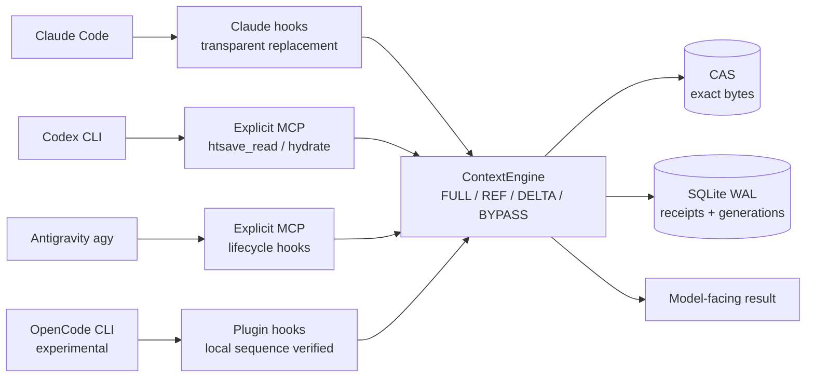

<!-- Language Switch -->
<p align="center">
  <strong>🌐 English</strong> |
  <a href="README.zh-TW.md">繁體中文</a>
</p>

---

# htsave

`htsave` 1.0.0 is a local, deterministic, lossless repeated-context layer for
Claude Code, Codex CLI, and Antigravity agy. It stores exact UTF-8 tool results
once per session and can return a confirmed reference or a verified
`unified-diff-v1` delta. It never normalizes bytes, summarizes content, performs
semantic/embedding search, or sends telemetry. agy is supported as an explicit
MCP integration, but its current live savings gate is red and carries no savings
claim.

OpenCode CLI has an experimental plugin integration described below. It has no
live savings evidence and is not included in the current release gates.

The package is versioned 1.0.0. The remaining v1 release evidence is tracked in
[docs/release-gates.md](docs/release-gates.md); this repository should not be
treated as a completed v1 release until those gates are green.

On Claude Code it saves tokens transparently: repeat a command and its output
comes back as a reference instead of the full text, with nothing to change in
how you work. On Codex CLI only the explicit MCP tools save tokens, because
Codex has no supported way to replace a tool result. On agy, the same explicit
MCP tools are available alongside fail-open lifecycle hooks.

## At a glance

`htsave` intercepts repeated context at the host boundary. The first result is
stored as exact bytes; later results become a compact `REF` or a verified
`DELTA`, while `htsave_hydrate` can restore the original bytes exactly.



### Supported host matrix

| Host | Install | Model-facing path | Transparent replacement | Historical evidence (not reverified) |
| :--- | :--- | :--- | :---: | :--- |
| **Claude Code** | `htsave claude install` (plugin) | Shell hooks | ✅ Yes | 80/80; historical savings gate passed; not reverified |
| **Codex CLI** | `htsave codex install` | Explicit MCP: `htsave_read` / `htsave_hydrate` | ❌ No | 80/80; historical savings gate passed; not reverified |
| **Antigravity agy** | `htsave agy install` | Explicit MCP + lifecycle hooks | ❌ No | 80/80; integration installed, savings gate red |

OpenCode CLI remains experimental. `htsave opencode install` is available for
local integration checks, but no live benchmark or release savings gate has
been recorded for it. Known bridge limitations are tracked in
[docs/release-gates.md](docs/release-gates.md).

### Historical live models (not reverified)

This table lists models used in real benchmark executions, not merely names in
defaults or test fixtures.

| Model | Host / path | Executions | Observed result |
| :--- | :--- | ---: | :--- |
| `gpt-5.6-luna` (low) | Codex CLI / explicit MCP | 80/80 | ✅ Historical pass; not reverified; 30.43%–41.69% median reduction |
| `claude-haiku-4-5-20251001` | Claude Code / transparent shell | 80/80 | ✅ Historical pass; not reverified; 92.40%–94.91% median reduction |
| `gemini-3.7-flash-low` | agy / MCP v2; v3 zero-hydrate | 80/80 per run | ⚠️ Red; v2 −18.69%–26.07%, v3 −4.32%–22.80% |
| `gemini-3.1-pro-low` | agy / MCP v1; v3 zero-hydrate | 80/80 per run | ⚠️ Red overall; v1 3.31%–48.44%, v3 7.02%–43.78% |
| `claude-sonnet-4-6` | agy / explicit MCP | 28/80 | ⏸ Partial, quota-limited; 2.27% on 10 completed pairs |

`gpt-5.6-luna` and the agy models are local model selections for these runs;
token counts do not imply official prices or discounts. Detailed scenario
tables, manifest paths, and audit notes are in [verify.md](verify.md).

No live OpenCode benchmark is included in this table.

The code also names `gpt-5.6-sol` (Codex benchmark default), `claude-opus-5`
(Claude default/test fixture), and `gpt-5` (CLI estimator/hydrate default).
`claude-3-5-haiku` is an unavailable historical alias. These are not live
benchmark evidence and are intentionally excluded from the table above.

## Install

Python 3.11+ is supported on Linux, macOS, and Windows:

```bash
uv tool install htsave   # runtime: htsave, htsave-claude-hook, htsave-mcp on PATH

htsave claude install    # Claude Code: the htsave plugin from its marketplace
htsave codex install     # Codex CLI: managed plugin marketplace
htsave agy install       # Antigravity CLI: skill + MCP + hooks in ~/.gemini/config/
htsave doctor
```

On Claude Code, htsave is a plugin, so it can also be installed from inside
Claude Code, after the runtime above:

```text
/plugin marketplace add ChingFuHan/htsave
/plugin install htsave@htsave
```

The plugin carries the hooks, the MCP server, and the skill; its commands run
the runtime from PATH. `htsave claude install` runs the same two steps through
`claude plugin` (`--marketplace PATH` uses a local checkout) and removes what
older releases wrote into `settings.json` and `~/.claude/skills/`, keeping every
foreign hook and MCP server. Restart Claude Code afterwards.

Installation and removal are idempotent, and `htsave agy install` only adds
entries tagged as its own — existing hooks and MCP servers in your
configurations are left exactly as they were. Install also loads tiktoken's
encoding once; it is cached under the user cache directory unless
`TIKTOKEN_CACHE_DIR` is set, so hooks do not need the network afterwards. The
experimental OpenCode installer applies the same ownership rule. All `uninstall`
commands preview their change unless `--yes` is supplied, and never remove
session data. `gc` is a dry-run unless `--apply`; `clear` is a dry-run unless `--yes`.

## Skill commands

On Claude Code, `/htsave:htsave` activates the skill — it informs the model about
HTSAVE/1 transport frames and how to call `htsave_hydrate` when full bytes are
needed. On Codex CLI, `$htsave` triggers the same skill. On Antigravity CLI,
the skill is auto-discovered from `~/.gemini/config/skills/htsave/`.

The skill ships with the Claude Code plugin and is installed automatically by
`htsave codex install` and `htsave agy install`.

## Experimental OpenCode integration

Run `htsave opencode install` in an OpenCode project. The installer manages
`.opencode/plugins/htsave.js` and `.opencode/skills/htsave/SKILL.md`, and migrates
only its own legacy `.mjs` plugin. OpenCode 1.18.23 discovers `.js`/`.ts`, not
`.mjs`. Foreign files and MCP configuration are preserved; a conflicting
`htsave` MCP entry disables this bridge instead of being overwritten.

The plugin uses `tool.execute.before` / `tool.execute.after`, real `sessionID` /
`callID`, and native local-MCP configuration. It exposes `htsave_htsave_read` and
`htsave_htsave_hydrate`. Receipts are confirmed only after exact output appears
in model input and a later tool call occurs; parallel calls cannot confirm each
other. Context pruning, compaction and restart invalidate prior possession.

The generated bridge and actual OpenCode 1.18.23 have local fake-model tests for
FULL, REF, DELTA, exact hydration and skill loading. These tests do not establish
real-model savings or compatibility with other versions. `status` checks owned
files and Python imports, not model behavior. See
[OpenCode evidence and limits](docs/release-gates.md#opencode-experimental-integration--no-release-savings-gate).

## Runtime paths

There are two supported data paths:

1. The explicit `htsave_read` and `htsave_hydrate` MCP tools. The PreToolUse
   hook adds a one-use, generation-bound capability. The reader accepts relative
   or absolute paths only after canonical resolution proves containment inside
   the active workspace; it also rejects symlink escapes, directories, special
   files, invalid UTF-8, and invalid line ranges.
2. Lifecycle hooks for SessionStart, PreToolUse, PostToolUse, PreCompact,
   SubagentStart/Stop, and Stop. They maintain generations, receipts, and
   crash-safe recovery state.

Lifecycle events are host-specific: Claude Code and Codex expose compact and
subagent events; agy exposes explicit MCP lifecycle hooks; experimental OpenCode
uses model-input snapshots, tool before/after, compaction, and disposal. Disposal
does not confirm receipts.

If `htsave_read` receives missing, malformed, or expired capability metadata, it
performs one raw read inside `fallback_workspace` (or the process working
directory), without session cache reuse. An accepted capability binds the read
to its session workspace: read validation failures raise and never switch to
the fallback workspace. After a successful read, `ContextEngine.decide` failures
of type `HtsaveError`, `OSError`, or `sqlite3.Error` return that exact raw text.
Other failures after capability acceptance propagate. `htsave_hydrate` always
requires a valid capability and a
same-session reference. A FULL delivery may be the original text; `HTSAVE/1`
frames are used for transformed deliveries and recovery.

On **Claude Code**, the lifecycle hooks also replace repeated results in place
through `hookSpecificOutput.updatedToolOutput`. Only results whose model-facing
bytes are unambiguous are touched: `Bash` stdout when stderr is empty and the
call was neither interrupted nor an image, `Read` file content, and single-text
non-error MCP results. Everything else passes through untouched. Note that
Claude Code already de-duplicates an identical re-`Read` of an unchanged file on
its own, so htsave earns its keep on repeated command output, repeated MCP
results, and re-reads of files that changed slightly.

On **Codex CLI**, only the MCP tools save tokens. The adapter treats a parseable
Codex version as an opportunity to try the documented hook contract and
validates each event's required fields, so additive Codex updates do not require
an htsave reinstall. `PreToolUse.updatedInput` carries the one-use MCP
capability; malformed or changed events fail open. Codex still has no supported
successful arbitrary-result replacement response for `PostToolUse`, so that
adapter remains observer-only and returns `{}` to preserve the original result.
It does not use `block`, `continue:false`, `updatedMCPToolOutput`, transcript
parsing, hosted-tool interception, or a wire/app-server proxy. Transparent
replacement remains an explicit release gate until Codex publishes the
contract.

All state is local below the platform user-data directory (override with
`HTSAVE_STATE_DIR`), split by a SHA-256 session key. Each session has an
immutable CAS and SQLite WAL registry. POSIX state uses `0700` directories and
`0600` files; Windows state is restricted to the current user. There is no
automatic GC or cross-session reuse.

## Historical live benchmark evidence (not reverified)

The recorded harness completed 80/80 paired executions per host (four
scenarios, ten baseline/treatment pairs each). The gate is the median of the
ten pairwise reductions in uncached `input_tokens`, with a 30% threshold:

- **Claude Code**, transparent shell path: 92.40%–94.91%, passed.
- **Codex CLI**, explicit MCP path: 30.43%–41.69%, passed.
- **agy**, explicit MCP path: −18.69%–26.07%, red. agy spills large tool output
  to brain files and Gemini's KV cache absorbs repetition, so neither arm
  re-bills full content; agy has no result-replacement hook equivalent to
  Claude Code's `updatedToolOutput`.

These are historical records: the manifests are not present locally, so the
figures were not recomputed. Usage accounting is host-specific, so compare
reductions only within one host, model, and path; they are not cost or pricing
claims. Per-scenario tables, exact fractions, the agy forensics, and the
reproduction protocol are in [verify.md](verify.md).

## Operator commands

```text
htsave claude install|uninstall|status
htsave codex install|uninstall|status
htsave agy install|uninstall|status
htsave opencode install|uninstall|status
htsave doctor
htsave stats [--session-key KEY]
htsave inspect [--session-key KEY]
htsave hydrate REF --session-key KEY
htsave gc [--apply]
htsave clear (--session-key KEY | --all) [--yes]
htsave benchmark run --output DIR [--host claude|codex|agy|opencode] [--path mcp|shell]
                     [--max-executions N] [--confirm-paid-runs]
htsave benchmark run --output DIR --resume [--confirm-paid-runs]
htsave benchmark report DIR/manifest.json
```

Decision thresholds use `tiktoken` estimates and are labelled as estimates;
they are not billed usage. The paired benchmark uses host-specific usage parsers
for Codex, Claude, and agy; OpenCode harness support remains experimental.
Accounting bases are described above. Paid runs require `--confirm-paid-runs`.

`--host` picks which agent CLI is measured and `--path` which delivery path.

`claude` is the default and measures the transparent path: the arm is simply
whether htsave's hooks are installed in that attempt's isolated
`CLAUDE_CONFIG_DIR`, so the operator's own hooks and MCP servers are out of both
arms. `codex` defaults to the `mcp` path, where both arms call `htsave_read` and
the baseline returns raw text; its `shell` path stops before spawning, because
Codex has no transparent-replacement contract yet.

`--max-executions N` runs at most N slots and stops, and `--resume` finishes the
rest — prove the wiring with one pair before paying for forty.
See [docs/architecture.md](docs/architecture.md) and
[docs/release-gates.md](docs/release-gates.md) for invariants and acceptance
evidence.

## Development

The complete test suite includes OpenCode acceptance tests requiring Node.js 22
and OpenCode 1.18.23. Missing prerequisites fail that gate explicitly. The host
tests use an isolated local fake model, not a paid model provider.

```bash
uv sync --extra dev
uv run pytest -q
uv run ruff check src tests
uv run htsave --json doctor
uv build
```

## License

htsave is distributed under the MIT License. See [LICENSE](LICENSE).
