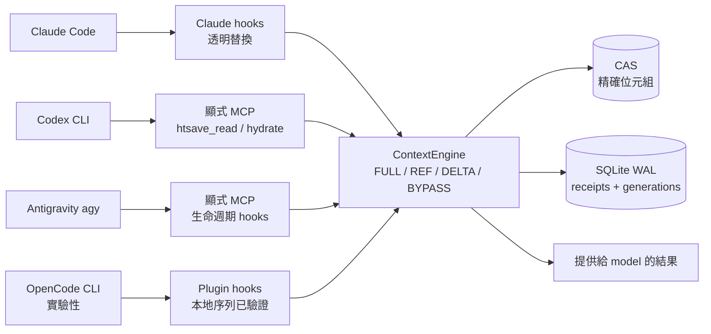

<!-- Language Switch -->
<p align="center">
  <a href="README.md">English</a> |
  <strong>🌐 繁體中文</strong>
</p>

> [!NOTE]
> 本文件為英文 README 的翻譯版本。如有出入，以 [英文版](README.md) 為準。

---

# htsave

`htsave` 1.0.0 是一個本地、確定性、無損的重複內容快取層，適用於 Claude Code、
Codex CLI 和 Antigravity agy。它將精確的 UTF-8 tool 輸出結果在每個 session 中只
儲存一次，後續可回傳已確認的參考指標或經驗證的 `unified-diff-v1` 差異。它絕不會
正規化位元組、摘要內容、執行語意/嵌入搜尋，也不會傳送遙測資料。agy 支援顯式 MCP
整合，但目前的實機節省 gate 為紅燈，不作任何節省聲明。

OpenCode CLI 有下方所述的實驗性 plugin 整合。目前沒有實機節省證據，也不列入現行
release gate。

本套件版本為 1.0.0。剩餘的 v1 發佈驗收項目追蹤於
[docs/release-gates.md](docs/release-gates.md)；在所有驗收項目通過之前，本專案
不應被視為已完成的 v1 正式版本。

在 Claude Code 上，它能透明地節省 token：重複執行一個指令，其輸出會以參考指標
而非完整文字回傳，你的工作流程完全不需要改變。在 Codex CLI 上，只有明確使用 MCP
tools 才能節省 token，因為 Codex 目前沒有支援替換 tool 結果的方式。在 agy 上，同樣
提供顯式 MCP tools，並搭配 fail-open 生命週期 hook。

## 一眼看懂

`htsave` 在 host 邊界攔截重複內容。第一次結果以精確位元組儲存；後續結果會變成
精簡的 `REF` 或經驗證的 `DELTA`，需要時 `htsave_hydrate` 可逐字節還原原始內容。



### 支援平台矩陣

| 平台 | 安裝指令 | 提供給 model 的路徑 | 透明替換 | 歷史證據（未重新驗證） |
| :--- | :--- | :--- | :---: | :--- |
| **Claude Code** | `htsave claude install`（外掛） | Shell hooks | ✅ 有 | 80/80；歷史節省 gate 通過；未重新驗證 |
| **Codex CLI** | `htsave codex install` | 顯式 MCP：`htsave_read` / `htsave_hydrate` | ❌ 無 | 80/80；歷史節省 gate 通過；未重新驗證 |
| **Antigravity agy** | `htsave agy install` | 顯式 MCP + 生命週期 hooks | ❌ 無 | 80/80；整合已安裝，節省 gate 紅燈 |

OpenCode CLI 仍屬實驗性功能。`htsave opencode install` 可用於本地整合檢查，但目前
沒有實機 benchmark 或 release 節省 gate 證據。已知 bridge 限制記錄於
[docs/release-gates.md](docs/release-gates.md)。

### 歷史實測模型（未重新驗證）

下表只列出實際執行過 benchmark 的模型，不包含僅出現在預設值或測試 fixture
中的名稱。

| 模型 | Host / 路徑 | 執行數 | 實測結果 |
| :--- | :--- | ---: | :--- |
| `gpt-5.6-luna` (low) | Codex CLI / 顯式 MCP | 80/80 | ✅ 歷史通過、未重新驗證；節省中位數 30.43%–41.69% |
| `claude-haiku-4-5-20251001` | Claude Code / 透明 shell | 80/80 | ✅ 歷史通過、未重新驗證；節省中位數 92.40%–94.91% |
| `gemini-3.7-flash-low` | agy / MCP v2；v3 零 hydrate | 每次 80/80 | ⚠️ 紅燈；v2 −18.69%–26.07%，v3 −4.32%–22.80% |
| `gemini-3.1-pro-low` | agy / MCP v1；v3 零 hydrate | 每次 80/80 | ⚠️ 整體紅燈；v1 3.31%–48.44%，v3 7.02%–43.78% |
| `claude-sonnet-4-6` | agy / 顯式 MCP | 28/80 | ⏸ 部分完成、受 quota 限制；10 組完成 pair 為 2.27% |

`gpt-5.6-luna` 與 agy 模型是本次測試選用的本地 model；token 數不代表官方價格或
折扣。完整情境表、manifest 路徑與稽核說明請見 [verify.md](verify.md)。

上表不包含 OpenCode 的實機 benchmark。

程式中另外出現 `gpt-5.6-sol`（Codex benchmark 預設）、`claude-opus-5`
（Claude 預設／測試 fixture）及 `gpt-5`（CLI estimator／hydrate 預設）。
`claude-3-5-haiku` 是不可用的歷史 alias。這些不是實機 benchmark 證據，因此刻意
不列入上方表格。

## 安裝

支援 Python 3.11+ ，適用於 Linux、macOS 和 Windows：

```bash
uv tool install htsave   # runtime：將 htsave、htsave-claude-hook、htsave-mcp 放上 PATH

htsave claude install    # Claude Code：從 marketplace 安裝 htsave 外掛
htsave codex install     # Codex CLI：managed plugin marketplace + ~/.agents/skills/ 的 $htsave skill
htsave agy install       # Antigravity CLI：將 skill + MCP + hooks 安裝至 ~/.gemini/config/
htsave doctor
```

在 Claude Code 上 htsave 是外掛，裝好上面的 runtime 後，也可以直接在 Claude Code
裡安裝：

```text
/plugin marketplace add ChingFuHan/htsave
/plugin install htsave@htsave
```

外掛提供 hooks、MCP server 與 skill，其指令從 PATH 執行 runtime。
`htsave claude install` 透過 `claude plugin` 執行同樣兩步（`--marketplace PATH`
可指定本地 checkout），並移除舊版寫進 `settings.json` 與 `~/.claude/skills/` 的
項目，其他 hook 與 MCP server 一律保留。完成後請重啟 Claude Code。

安裝與移除皆為冪等操作，且 `htsave agy install` 只會新增標記為自身所有的項目 —
你的配置中現有的 hook 和 MCP server 會被完整保留。安裝時也會先載入一次 tiktoken
編碼；除非設定了 `TIKTOKEN_CACHE_DIR`，編碼檔會快取在使用者 cache 目錄，之後 hooks
不再需要連網。所有
`uninstall` 指令在未提供 `--yes` 時都會預覽變更，且永遠不會移除 session 資料。`gc`
在未加 `--apply` 時為 dry-run；`clear` 在未加 `--yes` 時為 dry-run。

## Skill 指令

在 Claude Code 上，`/htsave:htsave` 會啟用 skill — 它告知 model 關於 HTSAVE/1
transport frame 以及如何在需要完整位元組時呼叫 `htsave_hydrate`。在 Codex CLI
上，`$htsave` 有相同功能。在 Antigravity CLI 上，skill 會從
`~/.gemini/config/skills/htsave/` 自動發現。

Claude Code 的 skill 隨外掛提供；`htsave codex install` 和 `htsave agy install`
會自動安裝各自的 skill。

## 實驗性 OpenCode 整合

在 OpenCode 專案執行 `htsave opencode install`。Installer 管理
`.opencode/plugins/htsave.js` 與 `.opencode/skills/htsave/SKILL.md`，只遷移自身擁有的
舊 `.mjs` plugin。OpenCode 1.18.23 會發現 `.js`／`.ts`，不會發現 `.mjs`。
外來檔案與 MCP 設定保持原樣；若有同名 `htsave` MCP 設定，bridge 會停用而不覆寫。

Plugin 使用 `tool.execute.before`／`tool.execute.after`、host 提供的 `sessionID`／
`callID` 與原生 local-MCP 設定，工具名稱為 `htsave_htsave_read` 和
`htsave_htsave_hydrate`。只有精確輸出出現在模型輸入，且後續工具呼叫發生時，才確認
receipt；同批平行工具不會互相確認。Context prune、compact 與重啟會使既有持有證據失效。

生成的 bridge 與真實 OpenCode 1.18.23 已有本地假模型測試，驗證 FULL、REF、DELTA、
精確 hydrate 和 skill 載入。這些測試不代表真實模型節省或其他版本的相容性。
`status` 檢查自有檔案與 Python import，不驗證模型行為。詳見
[OpenCode 證據與限制](docs/release-gates.md#opencode-experimental-integration--no-release-savings-gate)。

## 執行路徑

支援兩條資料路徑：

1. 顯式的 `htsave_read` 和 `htsave_hydrate` MCP tools。PreToolUse hook 會注入
   一次性、綁定 generation 的 capability。Reader 只在 canonical resolution 證明
   路徑仍位於 active workspace 內後接受相對或絕對路徑；也會拒絕 symlink 逃逸、
   目錄、特殊檔案、無效 UTF-8 和無效行範圍。
2. 生命週期 hook：SessionStart、PreToolUse、PostToolUse、PreCompact、
   SubagentStart/Stop 和 Stop。它們維護 generation、receipt 和防崩潰復原狀態。

生命週期事件依 host 而異：Claude Code 和 Codex 提供 compact 與 subagent 事件；agy
提供顯式 MCP 生命週期 hook；實驗性 OpenCode 使用模型輸入快照、tool before/after、compact 與 dispose；
dispose 不會確認 receipt。

`htsave_read` 收到缺少、格式錯誤或過期的 capability metadata 時，會執行一次原始且
受 `fallback_workspace`（或程序工作目錄）邊界限制的讀取，不重用 session cache。
接受 capability 後，讀取綁定 session workspace；讀取驗證失敗會拋出錯誤，不會切換
到 fallback workspace。成功讀取後，若 `ContextEngine.decide` 拋出 `HtsaveError`、
`OSError` 或 `sqlite3.Error`，則回傳該次讀取的精確原文；接受 capability 後的其他
錯誤繼續向外拋出。`htsave_hydrate` 一律需要有效 capability 和同一
session 的 reference。FULL 交付可以是原始文字；`HTSAVE/1` frame 用於轉換後的交付
和復原。

在 **Claude Code** 上，生命週期 hook 還會透過
`hookSpecificOutput.updatedToolOutput` 原地替換重複的結果。只有 model 端位元組
明確無歧義的結果才會被處理：`Bash` 在 stderr 為空且呼叫未被中斷也非圖片時的
stdout、`Read` 的檔案內容，以及單一文字的非錯誤 MCP 結果。其他一切都原封不動地
通過。請注意，Claude Code 本身已經會對未變更檔案的相同重複 `Read` 進行去重，因此
htsave 的價值在於重複的指令輸出、重複的 MCP 結果，以及重新讀取只有些微變更的
檔案。

在 **Codex CLI** 上，只有 MCP tools 能節省 token。Adapter 將可解析的 Codex
版本視為可以嘗試目前 hook 契約，並在每個事件驗證必要欄位，因此 Codex 增加版本時
不需要重新安裝 htsave；新增欄位會被忽略，格式改變則 fail-open。
`PreToolUse.updatedInput` 負責攜帶一次性 MCP capability。Codex 的
`PostToolUse` 仍沒有支援成功的任意結果替換回應，因此該 adapter 僅為觀察者模式，
回傳 `{}` 以保留原始結果。它不使用 `block`、`continue:false`、
`updatedMCPToolOutput`、transcript 解析、hosted-tool 攔截或 wire/app-server
proxy。透明替換仍是明確的 release gate，直到 Codex 發佈正式合約為止。

所有狀態都儲存在平台 user-data 目錄下（可用 `HTSAVE_STATE_DIR` 覆寫），以
SHA-256 session key 分隔。每個 session 有一個不可變的 CAS 和 SQLite WAL
registry。POSIX 狀態使用 `0700` 目錄和 `0600` 檔案權限；Windows 狀態限制為
當前使用者。沒有自動 GC 或跨 session 重用。

## 歷史實機 benchmark 證據（未重新驗證）

記錄中的 harness 對每個 host 完成 80/80 次配對執行（4 個情境，各 10 組
baseline/treatment）。gate 指標是十組未命中快取 `input_tokens` pairwise 節省比例
的中位數，門檻 30%：

- **Claude Code**，透明 shell 路徑：92.40%–94.91%，通過。
- **Codex CLI**，顯式 MCP 路徑：30.43%–41.69%，通過。
- **agy**，顯式 MCP 路徑：−18.69%–26.07%，紅燈。agy 會把大型工具輸出溢出到
  brain 檔案，Gemini 的 KV cache 也吸收了重複內容，兩臂都不會重新計費全文；
  agy 也沒有等同 Claude Code `updatedToolOutput` 的結果替換 hook。

以上是歷史紀錄：manifest 不在本地，數字未重新計算。用量計量依 host 而異，節省
比例只能在相同 host、model 與 path 內比較，不代表成本或定價。各情境表格、精確
分數、agy 鑑識與重現流程請見 [verify.md](verify.md)。

## 操作指令

```text
htsave claude install|uninstall|status
htsave codex install|uninstall|status
htsave agy install|uninstall|status
htsave opencode install|uninstall|status
htsave doctor
htsave stats [--session-key KEY]
htsave inspect [--session-key KEY]
htsave hydrate REF --session-key KEY
htsave gc [--apply]
htsave clear (--session-key KEY | --all) [--yes]
htsave benchmark run --output DIR [--host claude|codex|agy|opencode] [--path mcp|shell]
                     [--max-executions N] [--confirm-paid-runs]
htsave benchmark run --output DIR --resume [--confirm-paid-runs]
htsave benchmark report DIR/manifest.json
```

決策閾值使用 `tiktoken` 估算，並標示為估算值；它們不是帳單用量。配對 benchmark
依 Codex、Claude 與 agy 各自的 parser 讀取用量；OpenCode harness 仍屬實驗性。
各 host 計量基準如上所述。付費執行需要明確提供 `--confirm-paid-runs`。

`--host` 選擇要量測的 agent CLI，`--path` 選擇交付路徑。

`claude` 為預設值，量測透明路徑：實驗組的差異僅在於該次嘗試的隔離
`CLAUDE_CONFIG_DIR` 中是否安裝了 htsave 的 hook，因此操作者自身的 hook 和 MCP
server 不會出現在任何一組中。`codex` 預設為 `mcp` 路徑，兩組都呼叫
`htsave_read`，基準組回傳原始文字；其 `shell` 路徑在啟動前就停止，因為 Codex
尚無透明替換合約。

`--max-executions N` 最多執行 N 個 slot 後停止，`--resume` 完成剩餘部分 —
先用一對證明接線正確，再為四十對付費。
詳見 [docs/architecture.md](docs/architecture.md) 和
[docs/release-gates.md](docs/release-gates.md) 以了解不變式和驗收證據。

## 開發

完整測試包含 OpenCode 驗收，需有 Node.js 22 與 OpenCode 1.18.23；缺少必要工具時，
該 gate 會明確失敗。Host 測試使用隔離的本地假模型，不呼叫付費模型供應商。

```bash
uv sync --extra dev
uv run pytest -q
uv run ruff check src tests
uv run htsave --json doctor
uv build
```

## 授權

htsave 採用 MIT 授權條款發佈。見 [LICENSE](LICENSE)。
